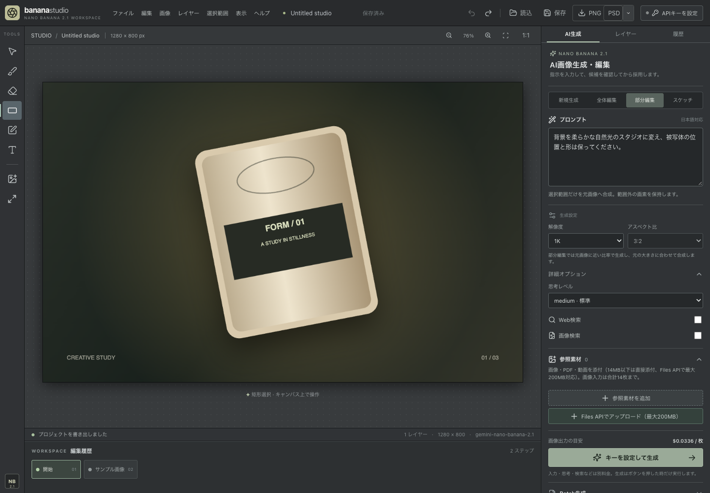

# Banana Studio

[](https://github.com/TadFuji/hunet-banana/actions/workflows/ci.yml) [](https://github.com/TadFuji/hunet-banana/actions/workflows/codeql.yml)

Photoshopに慣れた人のための、Nano Banana 2.1 画像生成・編集ウェブアプリ。レイヤー、選択範囲、手描きスケッチ、履歴を備えたキャンバスで、生成した候補を確認してから作品に採用できます。React・TypeScript製で、各利用者が自身のGemini APIキーを使います。

**[公開アプリを開く](https://hunet-banana-studio.vercel.app/)** · [図解取扱説明書（PDF）](output/pdf/Banana_Studio_図解取扱説明書.pdf) · [安全設計](docs/security.md)



## できること

| 領域 | 実装済み |
| --- | --- |
| キャンバス | PNG/JPEG/WebPの読込、画像・文字レイヤー、移動、不透明度、順序、表示切替、選択、履歴、PNG書き出し |
| AI生成 | 新規生成、全体編集、部分編集、スケッチ指示、参照素材、候補プレビュー、Web検索・画像検索と出典表示 |
| 設定 | 固定モデル `gemini-nano-banana-2.1`、1K/2K/4K、14種類の比率、3段階の思考設定 |
| 作業の継続 | ブラウザ内の1プロジェクト保存、JSONの読み書き、最大20件のBatch生成と状態確認 |

部分編集では、選択範囲を示す画像をモデルへ送り、採用時にアプリ内の元画像と候補を画素単位で合成します。**未選択部分の保持はアプリ側の合成によるもの**で、モデル自体にマスク専用APIや決定的な出力を仮定していません。元ファイルのEXIF・ICC・完全透明画素の不可視RGBまで保持する保証はありません。[仕組み](docs/architecture.md)

PSD互換、調整レイヤー、描画モード、CMYK、Google Files API、モデルの全オプションは未実装です。文書や参照素材には[サイズ制限](docs/app-design.md#batchと制限)があります。

## 使い始める

公開アプリはデスクトップ版Chromeで開けます。VercelへのログインやNode.jsのインストールは不要です。編集や保存はキーなしでも使えます。AI生成を使う場合は右上の「APIキーを設定」から**自分の**Gemini APIキーを入力します。設定だけでは画像生成されず、生成時のGoogle側の料金は利用者自身のプロジェクトに発生します。キー取得、料金の見方、初回生成は[図解取扱説明書](output/pdf/Banana_Studio_図解取扱説明書.pdf)を参照してください。料金表には確認日があり、実際の請求額はGoogleの最新料金と利用量で確認してください。

ローカルで動かす場合は、Node.js 22.12以上の22系、または24系を用意します。

```sh
git clone https://github.com/TadFuji/hunet-banana.git
cd hunet-banana
npm ci --ignore-scripts
npm run build
npm start
```

`http://127.0.0.1:4173/` を開いてください。取得済みのフォルダーなら、Macでは `Banana Studioを起動.command` から起動できます。APIキーを使うときは本番ビルドと `npm start` を使用します。`npm run dev` は画面開発用で、キー接続を無効にしています。詳しい手順は[開発ガイド](docs/development.md)へ。

## キーと作品の扱い

キーは入力後、専用Web Workerの一時メモリに保持します。React state、各Storage、JSONプロジェクト、URL、配信サーバーには保存しません。モデル接続の確認・生成・Batch操作時に、固定したGoogle APIオリジンへ `x-goog-api-key` ヘッダーで送信します。切断、ページ離脱、15分の無操作でWorkerを終了します。画面とWorkerには別々のContent Security Policyを適用します。[詳しい境界と残るリスク](docs/security.md)

ブラウザにキーを入力する以上、端末侵害・悪意ある拡張機能・配布コードの改ざんに対して漏洩ゼロは保証できません。生成時には指示・参照素材・必要な会話履歴がGoogleへ送られます。プロジェクトJSONには画像が含まれます。公開URLとローカルURLでは保存領域が別なので、移行にはJSONを書き出して読み込みます。

## 開発と検証

```sh
npm ci --ignore-scripts
npm run check
npm run test:e2e
```

`check` はビルドと単体テスト、文書内のローカルファイルリンクを確認します。E2Eは本番ビルドのローカルサーバーに対し、ダミーキーとモック応答で実行します。ブラウザの準備や検証範囲は[開発ガイド](docs/development.md)に記載しています。**自動テストは実APIキーや有料生成を使いません。** 利用者本人による新規画像の実生成成功は報告と候補画像で確認しましたが、実APIでの部分編集・スケッチ・検索・Batchや、他のGoogleプロジェクトの権限と請求は未確認です。[検証記録](docs/validation.md)

## 資料と参加

- [アーキテクチャ](docs/architecture.md) · [開発ガイド](docs/development.md) · [現行アプリ設計](docs/app-design.md)
- [セキュリティ設計](docs/security.md) · [脆弱性の非公開報告](SECURITY.md) · [貢献ガイド](CONTRIBUTING.md)
- [変更履歴](CHANGELOG.md) · [レビューと検証の記録](docs/re-review-2026-10-13.md) · [公開・運用記録](docs/deployment.md)
- [図解取扱説明書](output/pdf/Banana_Studio_図解取扱説明書.pdf) · [説明書の再生成](docs/manual/README.md) · [モデル調査](docs/research-2026-10-13.md)

このリポジトリは公開されていますが、現在 `LICENSE` はありません。再利用や再配布の許諾が必要な場合は、権利者に確認してください。
