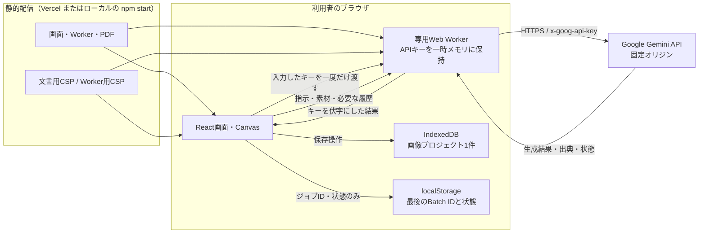

# アーキテクチャ

Banana Studioは、ブラウザ内の画像編集、専用Web WorkerからのGemini API呼び出し、静的ファイルの配信で構成されます。運営者が利用者の生成要求を中継するAPIサーバーはありません。実装上の境界を確認する場合は、[セキュリティ設計](security.md)も参照してください。

キー入力はpassword要素を一時的に通過し、入力欄を空にしてWorkerへ渡します。画面はキーそのものを状態管理せず、Worker内のキーの有無だけを表示します。解除、ページ離脱、15分の無操作でWorkerを終了します。生成準備中に接続先のキーが変わった場合は、接続世代の照合により旧操作の送信を止めます。ブラウザ内の悪意ある拡張や改ざんされた配布コードなどの残余リスクは残ります。

Workerの通信先は `https://generativelanguage.googleapis.com` に固定し、認証は `x-goog-api-key` ヘッダーです。Cookieを送らず、リダイレクトを拒否します。モデルIDは[型定義](../src/types.ts)に固定しています。生成のv1要求が404のときだけ、同じモデルのv1betaで対応を確認してから同じ要求を1回再送します。Batch APIはv1betaの固定パスを使います。

## 編集から採用まで

1. [App.tsx](../src/App.tsx) が文書・レイヤー・選択・スケッチをCanvas上で管理します。選択とスケッチはタブ内の作業状態です。
2. [protocol.ts](../src/api/protocol.ts) が指示・素材・設定からGeminiリクエストを作り、画像・出典・使用量・会話情報を検証して取り出します。
3. AI候補を表示します。利用者が採用するまでは文書に反映しません。
4. 部分編集では、[editor.ts](../src/lib/editor.ts) が元画像、候補、選択alphaを合成します。選択alpha 0のRGBAはアプリ内の元画像からコピーし、255は候補を使い、中間値はalphaを考慮して混合します。モデルの出力だけで周辺画素を保持する設計ではありません。
5. 保存時は許可したプロジェクトのフィールドと画像を検証します。キー、参照PDF・動画、会話、選択、スケッチはプロジェクトに入れません。

画像はCanvas処理後にPNGレイヤーとして扱います。元ファイルのバイト列やメタデータを維持する用途には向きません。文書と画像の上限は[現行設計](app-design.md#batchと制限)にまとめています。

## 配信境界

[security-headers.mjs](../security-headers.mjs) が、文書の `connect-src 'none'` とWorkerのGoogle限定 `connect-src` を定義します。[server.mjs](../server.mjs) がローカルで、[vercel-config.mjs](../vercel-config.mjs) と生成される `vercel.json` がVercelで、Workerのハッシュ付きファイルパスにだけWorker用CSPを適用します。開発サーバーではキー接続を禁止しています。任意の静的ホストに `dist` をコピーするだけでは、このヘッダー構成は再現されません。

## コードの場所

| パス | 役割 |
| --- | --- |
| `src/App.tsx`, `src/lib/editor.ts`, `src/lib/psd.ts` | 編集画面、描画・保存・画素合成・PSDバイナリ読み書き |
| `src/api/client.ts`, `src/api/security.worker.ts` | Workerの生成・接続寿命、Googleへの通信（生成・Batch・Files API） |
| `src/api/protocol.ts`, `src/types.ts` | リクエスト・応答の検証、固定モデルと型 |
| `security-headers.mjs`, `server.mjs`, `vercel-config.mjs` | CSPと静的配信 |
| `scripts/prepare-release.mjs` | 配信設定と説明書PDFを `dist` に配置 |
| `src/**/*.test.ts`, `scripts/**/*.test.mjs`, `tests/*.spec.ts` | 単体・配信設定・ブラウザテスト |
| `docs/manual/`, `output/pdf/` | 図解取扱説明書のソースと完成PDF |

設計変更時は、画面の説明、両方のCSP、保存スキーマ、テストを対応させて更新してください。[開発ガイド](development.md)に検証手順があります。
