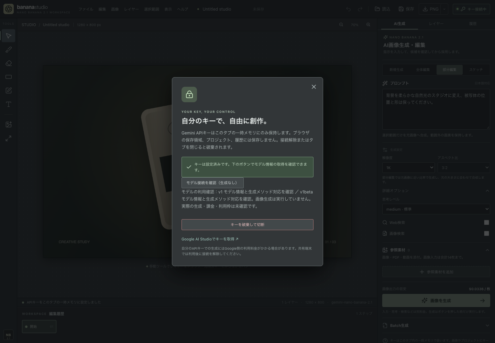
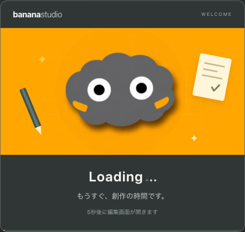

# Vercel公開・引き継ぎ

公開先は `hunet-banana`、アカウントは `tadfujis-projects`、本番ドメインは `https://hunet-banana-studio.vercel.app/`。公開結果は以下に記録。本人による初回の実生成でモデル利用不可のエラーが発生し、接続診断と404時の限定再試行を公開。更新後、本人の実APIによる初回生成成功の報告と生成候補の画像を確認済み。

## 配信構成

Viteの本番ビルドだけを静的配信する。GeminiのAPIキーやGoogleへの生成プロキシはVercelに置かず、利用者のWorkerからGoogleへ直接接続する。環境変数へのキー登録は不要。ソース、テスト、ログ、`.env`、ローカル作品は配信しない。

`npm run build` の最後で `scripts/prepare-release.mjs` が次を行う。

- `security-headers.mjs` を元に文書とWorkerのCSPを分けた `vercel.json` を生成。
- 本番ビルドをそのままMCP経由で配信できる `dist/vercel.json` を生成。
- 図解説明書を `dist/guide.pdf` へコピー。アプリのヘルプから同じオリジンで開く。

静的公開するファイルは `dist/index.html`、`dist/assets/` 内のJS・CSS、`dist/guide.pdf`、配信設定のみ。ハッシュ名のWorker専用ルートと、その他のパスのCSPルートは排他的。POST等の標準更新メソッドを405にし、不明なパスは404を保つ。外部へのrewriteやAPI Functionは追加しない。

Vercel ToolbarのProduction/Preview Feedbackは両方無効。ディレクトリ一覧も無効。Vercel Authenticationは `prod_deployment_urls_and_all_previews` を設定し、共有する本番ドメインは匿名アクセス可能に、個別デプロイとプレビューは認証付きにする。公開確認は認証情報のないブラウザとHTTPクライアントで行う。

## 更新と公開後の確認

1. 変更に応じて説明書を更新し、`npm run check` と `npm run test:e2e` を実行。
2. 作業内容をGitに記録し、対象のアカウント・プロジェクトを指定して本番ビルドを配信する。新たな生成SDKや解析サービス、環境変数を追加しない。
3. 公開後、以下でダミーキー・モック応答のブラウザ検査を行う。利用者の普段のブラウザとは別のChromeプロファイルを使う。

```sh
PLAYWRIGHT_BASE_URL=https://hunet-banana-studio.vercel.app npm run test:e2e
```

4. 画面とWorkerのCSPの完全一致、クエリ付きURLとHEAD、HTTPS、PDFのMIME、第三者script不在、匿名アクセス、保存・生成候補・部分編集・切断を確認。
5. 実APIは利用者本人が公開アプリの入力欄にキーを貼り、1K・検索オフで1枚生成。成功後、採用・PNG書き出し・切断を確認する。本人のキーの値をチャットに書かない。モックの成功と実APIの成功を区別して記録する。

実キーの操作中にはブラウザ自動化や通信記録を実行しない。キーの取得・課金・権限・利用枠の設定はGoogle側で本人が行う。エラーを共有する場合はアプリの短いエラー文だけを共有する。

## 2026-10-13の本番公開結果

- 本番共有URL: https://hunet-banana-studio.vercel.app/
- Vercelプロジェクト: `hunet-banana` / `prj_yM9rdiqB36g5oF8ywAUFVayd2DG3`
- デプロイ: `dpl_4r6VoGNn7jC8hWXAkhr2fGWGb86V`、target production、state READY。
- 公開ソースコミット: `7eb5bafb6511f6c3aee5cd001f3f709224a54a19`。
- https://hunet-banana.vercel.app/ も公開時に同じデプロイへ自動割当され、匿名200を確認。説明書と利用案内はstudio側へ統一する。オリジンが異なるためブラウザ内の作品保存は共有されない。
- 単体15件、ローカルE2E24件、公開URLのE2E24件が成功。公開E2Eは19.7秒。
- 公開URLの匿名200、個別デプロイURLの認証への302、更新メソッドPOST/PUTと任意メソッドBREWの405を確認。個別デプロイURLは `hunet-banana-anc6wtwu5-tadfujis-projects.vercel.app`。
- 文書とWorkerのCSP、その他6種の共通ヘッダーの完全一致、クエリ付きURL・HEAD、HSTS、PDF MIME、第三者script不在を検証。
- Googleの実APIは未使用。実キーを取得・表示・送信記録していない。本人に1K・検索オフで1枚生成、採用、PNG書き出し、切断を案内済み。

公開レスポンスとローカルビルドのバイト一致を確認したSHA-256:

| ファイル | バイト数 | SHA-256 |
|---|---:|---|
| index.html | 402 | `7ea554d30f31a50446d9fce60fa725611d29d0f9a1b47979d86783a7c53fad23` |
| guide.pdf | 4090644 | `7a09303a4e8852ba1a0892630d37b81e23de71f9fe8a0b7c539de67c6ba08373` |
| assets/index-BgITURxo.js | 257636 | `fa52105c58b1ec2b83804bf69b48a1ab03552666d9df947fa6217ed6a967c080` |
| assets/index-CwtLOypH.css | 19965 | `8512f96c930dd269ebbcca71ed9d58e2d15ee51c5ed5f7d972bffdd7a22f32a2` |
| assets/security.worker-BnNFa0Lb.js | 7802 | `8ec0242e348fa203da67a86169d9f24b625ca967951e7821989641d528470ae0` |

配信設定自身は公開対象のHTTP取得で比較していない。Vercelが適用した最終レスポンスのヘッダー・ルート挙動を検証している。更新メソッドの明示拒否とVercel側の処理は、あらゆる任意メソッドの永続的な拒否を証明するものではない。静的配信で書き込み用APIは存在しない。

## 初回実生成エラーへの更新（2026-10-13）

本人が新規生成・1K・1:1・検索オフで試し、「指定モデルまたはBatchが利用できません」のエラーを報告。スクリーンショットでも設定と公開URLを確認した。根本原因はこのメッセージだけでは確定できない。元のモデルIDとv1 generateContent経路は[Googleの公式仕様](https://ai.google.dev/gemini-api/docs/generate-content/image-generation?hl=en)と一致しており、ID誤記・v1非対応と断定していない。

- 更新ソース: `85b6fd3059f02359a48c41ff3b1508e0d5789f99`。
- デプロイ: `dpl_DZJvCGQQLSr9tq9cb6fPCSBYNKRx`、production / READY。同じ本番ドメインに反映済み。
- キー設定に「モデル接続を確認（生成なし）」を追加。固定Googleへのモデル情報GETだけを行い、v1とv1betaの結果を固定文で表示する。画像生成と生成の課金・利用枠の確認は行わない。
- 通常生成のv1が404の場合のみ、v1betaで同じモデル名とgenerateContent対応を確認できれば、同一本文で1回だけ生成を試す。成功したAPI版はキー接続中のみ保持する。権限・利用枠・通信断から追加生成しない。
- Astraが重要差分を独立レビュー。診断結果の過大表示と事前GETエラーの分類を修正し、再レビューで解消を確認。
- ビルド・単体15件、ローカルE2E38件（23.2秒）、公開E2E38件（29.6秒）が成功。いずれも生成通信はダミーキーのモック。ユーザーのキーや通信記録には触れていない。
- 公開されたHTML・JS・CSS・Worker・説明書の全ファイルがローカルビルドと一致。公開側の文書/WorkerのCSP完全一致、HEAD/クエリ付きURL、同一オリジンのPDFと第三者script不在も再確認。
- 更新後は本人にChromeで再読み込みし、キー設定の診断結果だけを共有するよう案内。実生成成功の確認は引き続き必要。

更新後の公開ファイルSHA-256:

| ファイル | バイト数 | SHA-256 |
|---|---:|---|
| index.html | 402 | `f538b1371d4c0afeb3e2bc8db5caf5a6725ec9a090ada6e0b8a440962b726013` |
| guide.pdf | 4090644 | `7a09303a4e8852ba1a0892630d37b81e23de71f9fe8a0b7c539de67c6ba08373` |
| assets/index-CBj48v73.js | 258184 | `7dedaa8e81c3d58d0fa1ec276ef22db259a4c3bd3a2d3ed8853de951352490cf` |
| assets/index-CwtLOypH.css | 19965 | `8512f96c930dd269ebbcca71ed9d58e2d15ee51c5ed5f7d972bffdd7a22f32a2` |
| assets/security.worker-B1xDD4on.js | 9320 | `6e73e1232a023c93f70030d93c13f5d8086c5c42910addf014a185f1d652b2af` |



## 本人による実API生成成功（2026-10-13）

- 本人のモデル接続診断画面で、v1は404、v1betaは対象モデル名とgenerateContent対応を確認できたことを確認。
- 更新済み公開URLで新規生成・1K・検索オフ、「白い背景に赤いリンゴを1個」を再試行するよう案内し、本人から「うまくいきました」と回答を受けた。
- 添付された候補画面でも、白い背景の赤いリンゴ1個と「キャンバスに採用」ボタンを確認。実APIから生成画像が返るところまで、本人の報告と画像で確認できた。実際に使われたAPI版の通信ログは取得していない。
- 初回の案内は生成→キャンバスに採用→PNG書き出し→キー切断の流れ。回答は全体の成功報告として記録するが、採用・PNG書き出し・切断の各操作を個別に観察したとは扱わない。
- チャットの「候補を採用」という案内を、実際のボタン名「キャンバスに採用」に訂正。アプリと図解説明書のボタン名は元から一致していたため変更不要。
- この成功は本人のキー・初回新規生成の経路についての確認。他の利用者のキーや実APIの部分編集・スケッチ・検索・Batchの成功を証明するものではない。
- キーの値を取得・表示・保存せず、本人のブラウザ自動化や実通信記録も行っていない。今回の更新は記録のみで、公開コードの再配信は不要。

## ファビコン追加（2026-10-13）

添付された灰色キャラクターとオレンジ背景の画像をbuilt-in imagegenで編集し、上の灰色の線を除去。正方形の元画像を `assets/branding/favicon-source.png` に保存し、編集指示を同フォルダのREADMEに記録した。`public/favicon.ico` は16/32/48/64pxの4フレーム、PNGは32px、Appleアイコンは180px。HTMLから同一オリジンのアイコンだけを参照する。

- 公開ソース: `a99b657a1deb1e6d2804d861836a98b9f591acf6`。
- 本番デプロイ: `dpl_9jvhpUUNhkMDDT1FJziWojukvEth`、production / READY。共有URLは従来どおり。
- ビルドと単体15件、ローカルおよび公開URLの配信検査各2件が成功。文書/WorkerのCSPと説明書配信を再確認。
- 隔離ChromeでHTMLの3件のアイコン参照、各アイコンの公開HTTP200・画像MIME・ローカルファイルとのバイト一致、PNGのデコード寸法32/180px、ICOの4フレームを確認した。
- 画像生成コード・キー管理・外部接続先は変更していない。利用者の実キーや通常のブラウザには触れていない。

## 5秒の起動アニメーション公開（2026-10-13）

- 公開ソース: `ecd052443ff1285556594dbdc6749a125cd4280f`。
- 本番デプロイ: `dpl_7yj7prjGYeV1cirCMz8KuwM7RTL6`、production / READY。`hunet-banana-studio.vercel.app` と `hunet-banana.vercel.app` の両方に反映済み。
- 「Loading…」の歓迎ウィンドウを5秒表示し、灰色キャラクター・鉛筆・用紙を同一オリジンの画像とCSSでアニメーション表示。終了後に編集Appをマウントする。動きを減らす設定では静止表示。上の灰色の線は除去済みの画像を使用。
- ビルド・単体15件が成功。ローカル40項目は、全件実行で38件成功し、起動待ちが必要だった2件のテスト修正後に該当項目の再実行で成功を確認。詳細は [validation.md](validation.md)。
- 公開E2E8件が成功（47.6秒）。5秒境界・再読み込み・動きを減らす設定・BYOKのヘッダー送信と切断/再読み込み・アイドルキー破棄・リダイレクト拒否・文書/WorkerのCSP完全一致・同一オリジンの説明書配信を確認。
- 隔離Chromeでキャラクターの変形の変化と実時間約5.07秒を確認。起動中にGoogle通信なし、すべて同一オリジンの要求。終了後のAPIキー設定画面も開けることを確認した。
- HTML・JS・CSS・Worker・説明書・アイコン・キャラクター画像の公開バイトがローカルビルドと一致。別名URLのHTMLも一致。Worker・説明書は前回公開から同一ファイル。
- 検証の生成通信はダミーキーとモック。実キーの取得・使用や追加の有料生成は行っていない。



## 公開後の再レビュー修正（2026-10-13）

- 公開ソース: `b6e9cdd127677745c325700771a797ae742ede29`。
- 本番デプロイ: `dpl_5uGrWEWjzdMBBWjF8BoVVNbAAVCR`、production / READY。両方の共有URLに反映済み。
- 編集の画像準備中のキー切替で旧操作を新キーへ送信しない接続世代検査、画像検索の公式出典・検索語の表示、Batchの最終画像なし項目の失敗件数を修正。[再レビュー詳細](re-review-2026-10-13.md)。
- TypeScript・本番ビルド・単体18件、ローカル全41件（4.3分）と画面検査を強化した2件の再実行（19.1秒）、公開URLの全41件（4.4分）が成功。依存監査は開発依存を含む全体・本番依存のみの両方で指摘0件。Astra 2担当による修正差分の独立確認でも追加の重大な指摘はない。
- HTML・JS・CSS・Worker・PDF・アイコン・キャラクター画像の9ファイルが、本番URLの匿名HTTP200でローカルビルドとバイト一致。別名URLのHTMLも一致。個別デプロイURLはVercel認証へ302。
- 自動テストのAPI通信は隔離Chromeのダミーキーとモック。実キーの読取・使用や有料生成を行っていない。

公開ファイルのSHA-256:

| ファイル | バイト数 | SHA-256 |
|---|---:|---|
| index.html | 638 | `19aa3178a9fd5f7531573b4fab65cd9ebd542f0f0f07e93f23243acd21578f9e` |
| guide.pdf | 4090644 | `7a09303a4e8852ba1a0892630d37b81e23de71f9fe8a0b7c539de67c6ba08373` |
| favicon.ico | 11491 | `e73f18d312685915f6ca10768399938d5ed6a875a8f9f2e7781a193dfdff91ae` |
| favicon-32.png | 1850 | `9fe5aa43e75f2937526173707430a36350f9dc277bf5683ebb63966813c71cc8` |
| apple-touch-icon.png | 33068 | `eaf23ecff9160c8906ed1ea02186cafa140601bc8735f2623f7b94fc355bdfb1` |
| loading-character.png | 145344 | `a243db04de0902572a81f2f95d9ca137906bb77e44f0809bcaf59ac22133386b` |
| assets/index-CU3KTy8-.css | 24362 | `43a80668abcf0a252197a677f3156b9d167e9c50ad6f629b6d7650237fbcb579` |
| assets/index-YrsBj63-.js | 260252 | `9ae6534f5c85e7781e189a7c1d0cf656439181ca6cf683d3316fce075d684f01` |
| assets/security.worker-iewXD48_.js | 9609 | `4749b5770d37faf60260e0c4f6392f61ca334e702c62b309bb8216657be4c511` |

## メニュー開閉の修正を公開（2026-10-20）

- 公開ソース: `a543d58c02fed17d22538bbb8938cc9a039654b2`（PR #10、`main` へSquash統合）。
- 本番デプロイ: `dpl_DMNwaimz4hGAkvQQNSKuTYUdoueU`、production / READY、Vercel CLI 64.2.0 で `dist` を配信。`hunet-banana-studio.vercel.app`・`hunet-banana.vercel.app` に割り当て済み。VercelプロジェクトはGitHubと自動連携していないため、統合後に手動で配信した。
- 上部メニューが外側のクリック・項目選択・別メニューを開く操作（キーボード含む）・Escで閉じるよう修正。
- 公開URLの `index.html`・`assets/index-Bh6XR9U9.js`・Worker・説明書PDFがローカルビルドとSHA-1で一致。文書とWorkerのCSPヘッダーを確認。公開URLに対するE2E 49件が成功（5.0分）。公開版でファイルメニューを開き、外側のクリックで閉じることを目視で確認。
- 検証の生成通信はダミーキーとモック。実キーの使用や有料生成は行っていない。

| 変更したファイル | バイト数 | SHA-256 |
|---|---:|---|
| index.html | 638 | `23ae8d7bf5453813ee4721eef0c8eaae3be654ea3237345a49541eed08132705` |
| assets/index-Bh6XR9U9.js | 292907 | `a9a3d287ed01b8d29ef986bc0b0176e92847219e24b12619e21d569f74bdb4c5` |

## PSD読み書き・描画モード・Files API・Batch拡張・大容量画像送信制御を公開（2026-10-21）

- 公開ソース: `1b9b7bd7103b98d8ec91a7405bf543a8b5a87acd`（PR #14）および `6513c8103fbd18b47f7a5c8d74d9d36c3134103b`（PR #15、GitHubの必須7チェック通過後に `main` へSquash統合）。
- 本番デプロイ: `ifwF4wgqNrpevrKxVn6mDxRKasmt`（前回 `7icu5iB6iXRGabDEwEkuUxBew2z4`、初回 `6pr4LpnkvgB8gyFfV4jutPmGBWLK`）、production / READY、Vercel CLI 65.0.0 で `dist` を配信。`https://hunet-banana-studio.vercel.app/` および `https://hunet-banana.vercel.app/` に反映済み。
- PSD（`.psd`）バイナリの読み込み・書き出し（RGB 8bit、Raw・PackBits RLE展開、Unicodeレイヤー名 `luni`、ユーザーレイヤーマスク `-2`/`-3` のアルファ合成、文書外へまたがるレイヤーの可視領域保持）、12種類のレイヤー描画モード、Google Files API（最大200MBアップロード・状態更新・削除・`fileData` 参照・途中失敗時の自動削除・キー切断時の参照クリア・6〜14MB参照素材の自動Files API昇格）、API送信用キャンバス画像の自動リサイズ・圧縮（長辺2048px・WebP/JPEGフォールバック、部分編集用の元画像PNGはフル解像度維持）、Batch生成でのキャンバス編集・参照素材・Web/画像検索・未選択画素保持採用、および図解取扱説明書PDF（第1版・改訂3、`/guide.pdf`）を公開。
- 公開URLの `index.html`・JS・CSS・Worker・説明書PDFがローカルビルドとSHA-256で完全一致。公開URLに対する `publication.spec.ts`（文書とWorkerのCSPヘッダー完全一致、HEAD・クエリ付きURL、PDF配信、第三者スクリプト不在）2件および新規機能E2E 3件がすべて成功。
- 検証の生成通信はダミーキーとモック。実キーの使用や有料生成は行っていない。

| 変更したファイル | バイト数 | SHA-256 |
|---|---:|---|
| index.html | 638 | `c1b58c2da1e5abf30d18b20c8441b6e1da170c9e170d2cc9390b419844f20227` |
| guide.pdf | 5671826 | `92d65eebd02cea42711650ce56a045244243a8c0225aab69cd9ef14ac4f12e94` |
| assets/index-slrMbTn8.js | 314641 | `d822c4adfe4e6742853543c1174b6d4e09e1f11933c0b025339b3d19ca998c45` |
| assets/index-CcYx-zwN.css | 25025 | `139966208c49a2735f38cc0c5b16c4d853ff91194e4f701e84d048f39a17f4c9` |
| assets/security.worker-B1OWymYQ.js | 11930 | `1b8aabb7516aa8839b6d0d337cd74cc88034879d54529d2afad9f951a38ff50e` |
