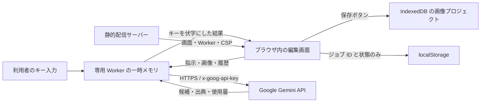

# BYOK セキュリティ設計

2026-10-13。各利用者が自身のGemini APIキーを使う構成です。運営者の共有キー、運営者の生成プロキシ、ログ収集、解析タグを設けていません。

## データ経路と信頼境界

キー入力はpassword要素を一時的に通過します。値を読み取ったら入力欄を空にし、React stateには入れずWorkerへ渡します。Workerはハードウェアの秘密保管装置ではありません。同一オリジンの悪意あるスクリプト、改ざんされた配布コード、ブラウザ拡張、開発者ツール、侵害されたOSは残余リスクです。キーがブラウザに存在するBYOK構成で「絶対に漏洩しない」との保証はできません。

## 実装した対策

| 対象 | 対策 |
|---|---|
| 永続化 | キーをCookie、各Storage、IndexedDB、ファイル、履歴に保存しない。プロジェクト書き出しは許可したスキーマだけを採用 |
| 通信 | 固定Googleオリジンと固定APIパス。キーはヘッダーにだけ付与。credentials omit、cache no-store、redirect error |
| URLの注入 | モデルを固定。Batch IDは `batches/[英数字・_・-]` のみ。入力からホストや任意パスを指定できない |
| Worker | Workerレスポンス自身にもCSP。Google API以外へ接続できない。中断・180秒のタイムアウト・80MBの応答上限 |
| 画面 | connect-src none、同一配信のスクリプトのみ、eval禁止、外部画像・フォント・埋め込み禁止。画像入力はPNG/JPEG/WebPのdata URLだけ |
| 結果表示 | Reactのテキスト表示。リンクは認証情報のないHTTPSだけ。新規タブはnoopener/noreferrer |
| 検索HTML | opaque originのsandbox iframe。script禁止、外部リソース禁止、form禁止。利用者がクリックする検索リンクは別タブに開く |
| 応答・ログ | Googleの生エラー本文を画面に出さない。成功応答内のキー文字列を再帰的に伏字化。アプリの要求・応答ログを出さない |
| 終了 | 解除、pagehide、15分無操作でWorkerをterminateし待機中の要求を解除。JavaScriptメモリの確実なゼロ化は保証しない |
| 配信 | Referrer-Policy、nosniff、フレーム禁止、COOP、Permissions-Policy、no-store。サーバーはGET/HEADのみ、既定は127.0.0.1 |
| 依存 | バージョン固定とlockfile。外部CDNや分析SDKなし。npm auditを確認 |
| プロジェクト読込 | 非表示を含む全画像をデコードし、実寸と合計画素を検証してから現在の文書を置き換える。不正な復元データでも初期文書を維持 |

文書の最大は各辺16,384px・3,200万画素・40レイヤーです。文書画素数×レイヤー数と、埋込画像の実寸の合計を、それぞれ1億2800万画素までとします。画像追加・生成候補採用などの経路でも実寸合計を検証し、保存した文書が次回の復元検査で拒否される状態を防ぎます。キャンバス拡張は全レイヤー分の割り当て前に画素数を検査します。これはアプリの入力制限であり、端末ごとのメモリ不足を完全に防ぐ保証ではありません。

通常ページはno-referrerですが、Googleへのfetchだけ `referrerPolicy: 'origin'` を指定します。対応する従来型キーのサイト制限ではオリジンの判定に使われることがあります。キーやプロジェクト名はRefererに含めません。新規AI StudioのAuth keyではHTTPリファラーによるアプリケーション制限を使えないため、この指定だけでキーの利用先が制限されるわけではありません。ブラウザ・Google側の制限設定により拒否される場合は、実プロジェクトで確認が必要です。

## 保存するもの・Googleへ送るもの

- IndexedDB: 保存ボタンを押した画像プロジェクト1件。APIキー・会話・思考署名・参照PDF/動画は含まない。
- localStorage: 最後のBatch IDと状態。過去のID全件を管理する機能ではないため、追加ジョブ作成前に必要なIDを控える。
- タブのメモリ: 編集履歴、描画選択、参照素材、採用した生成の会話・思考署名。
- Google: 生成時の指示、素材、必要な履歴、キー。BatchではGoogle側にジョブを作成する。

キーの切断はGoogleに送った素材の削除や、Batchの中止にはなりません。Batchの中止は別のボタンで明示的に依頼します。中止要求の受理は即時停止や請求取消の保証ではありません。Googleの保持・学習利用・料金の条件はサービス契約に依存します。[GoogleのAPIキーガイド](https://ai.google.dev/gemini-api/docs/api-key)、[Gemini APIの利用条件](https://ai.google.dev/gemini-api/terms)、[Batch APIガイド](https://ai.google.dev/gemini-api/docs/batch-api)

Googleは本番利用でサーバー経由の鍵管理を推奨します。本アプリは「利用者自身の鍵を運営者のサーバーに渡さない」という要件から、ブラウザ直接接続を選びました。このトレードオフを、サーバー側の秘密管理と同等の安全性とは見なしません。[APIキーガイド](https://ai.google.dev/gemini-api/docs/api-key)

## 利用者側の設定

1. このアプリ専用のキーを作る。既存の他サービスと共用しない。
2. Googleのキー画面で、対応するキー種別に応じてGenerative Language APIへのAPI制限を設定する。
3. 新規AI Studioのキーは通常Auth keyで、アプリケーション制限はIPアドレスのみ。HTTPリファラー制限には対応しない。IP制限を使う場合はGoogleに見える外部送信元IPを指定し、localhostや127.0.0.1は使わない。従来型キーは対応する制限が異なるため、キー種別と公式管理画面を確認する。[Googleのキー制限ガイド](https://docs.cloud.google.com/docs/authentication/api-keys#add_application_restrictions)
4. Googleプロジェクトの割り当てを用途に合わせ、課金アラートを設定する。予算アラートは課金の強制停止ではない。AI StudioのProject spend capは実験的機能で、反映遅延やBatch等による超過があり得る。[支出上限の公式説明](https://ai.google.dev/gemini-api/docs/billing#project-spend-caps)
5. 共有端末で使った後は切断する。不要になったキーや漏洩が疑われるキーはGoogle側で失効・交換する。

実キーをチャット、README、環境ファイル、Gitに貼る必要はありません。キーの取得とGoogle側の制限設定は利用者のアカウントで行います。

## 公開する場合の必須条件

2026-10-13に https://hunet-banana-studio.vercel.app/ へHTTPSで公開しました。`security-headers.mjs` の文書用CSPとWorker用CSPが、それぞれの実レスポンスに完全一致することを、GET・HEAD・クエリ付きURLで確認しています。HTMLだけのmeta設定や、Workerが親文書のCSPを自動的に引き継ぐという想定では不十分です。[MDN: WorkerのCSP](https://developer.mozilla.org/en-US/docs/Web/API/Web_Workers_API/Using_web_workers#content_security_policy)

Vercelには静的な本番ビルドと図解PDFだけを配信し、Geminiキーの環境変数や生成API Functionを設けていません。Production/Preview Feedbackを無効にし、公開画面に第三者スクリプトがないことを検証しました。本番ドメインの匿名アクセスは200、個別デプロイURLへの匿名アクセスはVercel認証への302を確認。POST・PUT・任意メソッドBREWは公開先で405でした。詳細は [公開記録](deployment.md) を参照してください。

配布コード・依存関係・ホストの改ざんを管理し、APIキーを扱うページに第三者タグを追加しないでください。TLS終端のプロキシでヘッダーが上書きされる場合は、最終レスポンスを検証します。`dist`を任意のホストへコピーしただけの状態や、Viteの開発サーバーをそのまま公開した状態を安全な公開と扱わないでください。

## 検証範囲

ダミーキーとモック応答で、本番ビルドのヘッダー、Googleへのヘッダー付与、URL・本文・DOM・Storage・コンソールにキーを残さないこと、伏字、検索iframeの隔離、リダイレクト拒否、切断・再読込・アイドル切断をテストしました。Astraによるソースの独立レビューと、修正後の再レビューを実施しています。詳細は [レビュー報告](review-2026-10-13.md) を参照。実キーでのGoogle利用・課金・権限・リファラー制限は未検証です。レビューとテストは将来の変更や端末侵害まで含めた漏洩の不存在を証明するものではありません。

## 2026-10-13 モデル接続診断と404への対応

キー設定画面のモデル接続診断は、Workerから固定Googleオリジンの `/v1/models/gemini-nano-banana-2.1` と `/v1beta/models/gemini-nano-banana-2.1` にGETする。キーは既存と同じヘッダーだけに付ける。応答本文を画面に渡さず、モデル名・generateContent対応またはHTTPステータスの固定分類だけを表示する。画像生成、生成の課金・利用枠確認は行わない。

通常生成のv1 POSTがHTTP404の場合のみ、v1betaのモデル情報を取得し、同じモデル名とgenerateContent対応を確認できれば、元と同一の本文でv1betaへ1回だけ生成POSTする。v1beta生成が成功した場合は、このキーの接続中のみAPI版を保持する。キーの再設定でv1へ戻る。401/403/429/5xx、通信中断から生成を再送せず、別モデル・別オリジンへの切替もしない。Batchの経路は変更していない。
